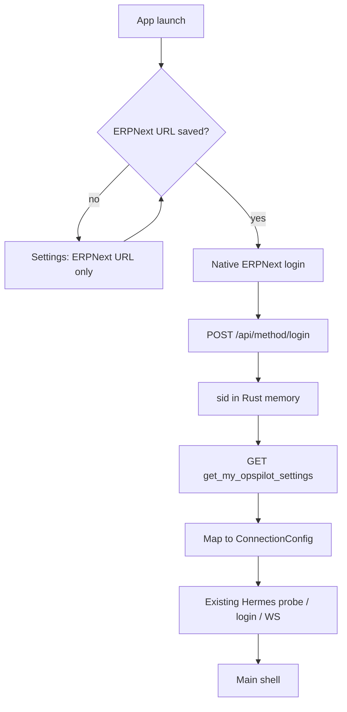

# ERPNext as OpsPilot settings vault

## Overview

OpsPilot no longer stores Hermes gateway credentials locally as user-edited settings.
ERPNext is the identity gate and the per-user settings vault. OpsPilot persists only the
ERPNext site URL; Hermes connection details live in a per-user DocType on that site.

See also [`v1.md`](./v1.md) for the Hermes protocol and shell contract.

## Decisions

| Decision | Choice |
|---|---|
| Login UI | Native OpsPilot form → `POST {site}/api/method/login` |
| ERPNext session (`sid`) | Process memory only — never written to disk |
| App close / restart / crash | User must log in again |
| Hermes settings edit | ERPNext Desk only (OpsPilot reads, does not write) |
| OpsPilot local settings | ERPNext site URL only |

## Authorities

Four parties, each authoritative for one thing:

- **Tauri (Rust)** owns the machine: ERPNext site URL on disk, in-memory ERPNext `sid`,
  HTTP to Frappe, Hermes probes / password-login / WS / `/api/fs`.
- **Vue renderer** owns the experience: boot gate (URL → login → shell), presentation,
  ephemeral interaction state.
- **ERPNext + `opspilot_frappe`** owns identity and Hermes settings (per User DocType).
- **Hermes gateway** owns the work: sessions, tools, model calls, streaming, remote FS.

## Boot flow

1. Load `{app_config_dir}/erpnext.json` → `{ site_url }`.
2. If missing → full-page Settings (ERPNext URL only).
3. If present → full-page Login (username / password). Never persist the password.
4. On success keep `sid` in memory; call `opspilot_frappe.api.get_my_opspilot_settings`.
5. Map DocType payload → existing `ConnectionConfig` → Hermes connect path.
6. Missing DocType row → honest error; Logout / Retry. Do not invent Hermes defaults.
7. Top-bar gear → ERPNext URL settings. Changing site clears memory session → login.
8. Logout → clear memory `sid`, return to login; keep saved site URL.

## Frappe app: `opspilot_frappe`

Install on each customer ERPNext site (`bench get-app` from this repo’s `frappe-app/opspilot_frappe`).

### DocType: `OpsPilot Settings`

- One document per User (`autoname: field:user`).
- Fields: `user`, `gateway_url`, `auth_mode` (`token` \| `password`), `gateway_username`,
  `gateway_password` (Password), `session_token` (Password), `extra_headers` (JSON text).
- Permissions: owner matching `user == frappe.session.user`; System Manager full.
- Controller rejects cross-user access.

### API

`GET /api/method/opspilot_frappe.api.get_my_opspilot_settings` with `Cookie: sid=…`.

Returns plaintext secrets via `doc.get_password(...)`. Guest / cross-user → error.
Do not use `/api/resource/...` for Password fields (masked as `******`).

Desk form is the only place users edit Hermes credentials. Desktop upsert is out of scope.

## OpsPilot persistence

| Store | Contents |
|---|---|
| `erpnext.json` | `{ site_url }` only |
| Rust memory | ERPNext `sid`, logged-in user id |
| Runtime `ConnectionConfig` | Derived from DocType for the current process (Hermes path unchanged) |

Never persist ERPNext password or `sid`. Prefer HTTPS for ERPNext and Hermes in production.

## UI contract (delta from v1)

- Settings = ERPNext site URL (not Hermes Save connection form).
- First screen after URL is saved = native ERPNext login.
- Shell (center + agent) only after login + successful settings fetch + Hermes connect attempt.
- Missing settings / bad login / Hermes down → distinct empty / error copy with a way forward.

## Progress log

| Phase | Status |
|---|---|
| Spec | Done |
| Frappe app (DocType + whitelist method) | Done |
| OpsPilot Rust ERPNext client | Done |
| Boot gate UI + Settings rewrite | Done |
| Wire DocType → Hermes connect | Done |
