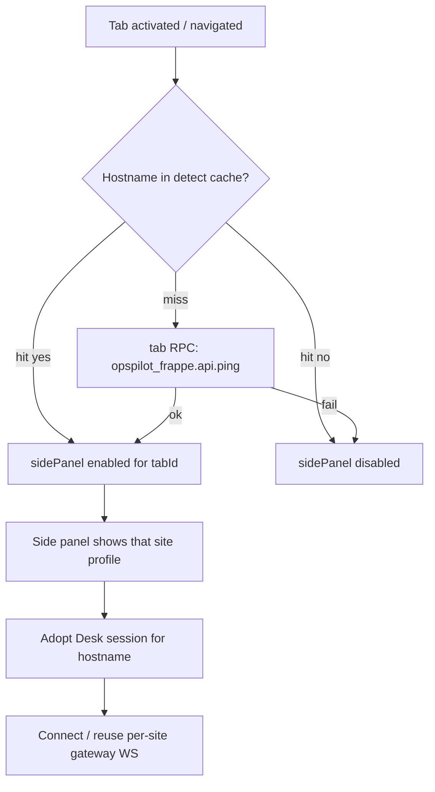

# Multi-site OpsPilot (per-origin profiles)

## Goal

OpsPilot enables only on tabs whose site has Frappe + `opspilot_frappe`. Each such site keeps its own Hermes connection, sessions, and chat cache. Switching to a non-OpsPilot tab hides the side panel entirely.

## Decisions

| Decision | Choice |
|---|---|
| Site identity | Hostname (lowercase), port ignored for matching (bench `:8000` vs bare host) |
| Panel gating | `chrome.sidePanel.setOptions({ tabId, enabled })` after `opspilot_frappe.api.ping` |
| Unrelated sites | Toolbar click shows `unavailable-popup.html` (reason); side panel stays closed |
| Detection cache | Per-hostname in `chrome.storage.session` (positive longer TTL, negative short) |
| Hermes sockets | One WebSocket per site key; disconnect one site without tearing down others |
| UI document | Single side-panel page; hydrate Pinia from the focused site’s profile |
| Site URL settings | Optional / advanced — normal boot uses the focused Desk tab’s URL |
| ERPNext `sid` | Still memory/`storage.session` only, keyed per site |

## Flow

## Authorities (unchanged seams)

- Native owns per-site networking + WS map + detect cache.
- Vue owns presentation for the **active** site key.
- Each site’s DocType still owns that site’s Hermes credentials.
- Each site’s Hermes gateway owns that site’s sessions/tools.

## Progress

| Phase | Status |
|---|---|
| Spec | Done |
| Icon refresh | Done |
| Background detect + tab-scoped panel | Done |
| Per-site gateway / connection / ERPNext session | Done |
| Side panel active-site hydrate | Done |
| Drop mandatory single site-URL gate | Done |
