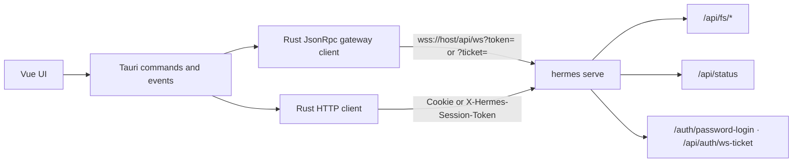

# OpsPilot v1 — Spec

## Overview

Build OpsPilot as a Tauri 2.0 remote-only Hermes client that speaks the same gateway protocol Hermes Desktop uses (`hermes serve` WebSocket JSON-RPC + `/api/fs`), with a clean Frappe UI shell covering chat, sessions, remote workspace files, and gateway settings.

## Product scope

A **remote-only** desktop client for an already-running Hermes backend (`hermes serve` / dashboard). No local Hermes install, voice, previews beyond center tabs, OAuth, multi-connection profiles, or projects UI.

| Surface | Behavior |
|---|---|
| Agent (right) | Streaming transcript + composer; resizable / toggleable; session tabs + clock history overlay |
| Workspace (left) | Toggleable Files / Browser rail; remote file tree; Browser opens a nested webview tab |
| Center | Tabbed workspace: file text preview, HTML/PDF artifact tabs (iframe/embed), browser tabs (nested Tauri webviews + URL chrome) |
| Settings | Gear → full settings page: single remote connection (Desktop Save connection form) |

## Protocol: match Hermes Desktop remote mode

OpsPilot uses the same seams Desktop uses against a remote gateway — not the OpenAI API server.



- **WebSocket JSON-RPC** at `{base}/api/ws?token=…` or `?ticket=…` (`https`→`wss`, preserve path prefix, append `/api/ws`).
- Core RPCs: `session.create`, `session.list`, `session.activate` / `session.resume`, `session.history`, `prompt.submit`, `session.interrupt` (+ pin/unpin/delete/archive best-effort). `ping` / `session.title` listed for Desktop parity but not required for v1 UX.
- Stream events: `gateway.ready`, `message.*`, `thinking.delta` / `reasoning.*`, `tool.*`, `error`. Approval/clarify blocking UI deferred.
- **REST**: `GET /api/status`; `GET /api/fs/default-cwd`, `list`, `read-text`; download helpers for Save As / preview.
- Auth (Desktop-compatible):
  - Probe `/api/status` + `/api/auth/providers`
  - Password/`basic`: `POST /auth/password-login` → cookies; REST via `Cookie`; WS via reminted `/api/auth/ws-ticket` → `?ticket=`
  - Legacy token: `X-Hermes-Session-Token` + `?token=`

Native-side networking (Rust) dials the remote WS — not the webview — to avoid Chromium HTTP/2 Extended CONNECT failures against proxied gateways.

## Stack

- Tauri 2 + Rust backend
- Vue 3 + Vite + TypeScript
- frappe-ui for shell primitives
- Pinia stores for connection, sessions, chat, files, layout, tabs
- Connection config persisted as `{app_config_dir}/connection.json` (password cleared; cookies kept). Layout/tabs use `localStorage`.

## Information architecture

```
┌──────────────────────────────────────────────────────────────┐
│ [panel]              OpsPilot              [chat] [settings] │
├──────────┬─────────────────────────────┬─────────────────────┤
│ Workspace│ Center                      │ Agent chrome:       │
│ Files /  │ [file|browser tabs…] +     │ [tabs…] + ⏱ ⋯ ▤   │
│ Browser  │ preview / nested webview    │ history overlay /   │
│ tree     │                             │ transcript+composer │
└──────────┴─────────────────────────────┴─────────────────────┘
```

- App top bar: left workspace toggle, centered product name, Online/Offline, chat + settings
- Agent chrome: open session tabs with ×, +, clock (searchable history / pin / groups), ⋯ export, panel toggle
- Center: shared tab strip for remote file previews, blob HTML/PDF artifacts, and nested Tauri webview browser tabs
- Settings: full-page overlay from top-right gear (hides native browser overlays while open)
- Visual: flat panels, hairline dividers, frappe-ui tokens — no nested cards

## Implementation phases

| # | Phase | Status |
|---|---|---|
| 1 | **Scaffold** — Tauri 2 + Vue-TS + frappe-ui; app id `com.opspilot.app` | Done |
| 2 | **Connection layer (Rust)** — config, auth probe/login/ws-ticket, `test_connection`, `GatewayClient` + events, `/api/fs` | Done |
| 3 | **Shell + settings** — Workspace \| Center \| Agent; Desktop-matching settings form | Done |
| 4 | **Sessions + chat** — history list, top tabs, streaming prompt, attachments, interrupt | Done |
| 5 | **Center workspace** — remote file tree + tabbed previews; nested webview browser; HTML/PDF artifacts | Done |
| 6 | **Polish** — empty/loading/error states, export transcript, README | Done (reconnect/CI thin) |

## Progress log

Shipped as an end-to-end remote client against a live `hermes serve` / dashboard gateway.

### Phase 1 — Scaffold
- Vite + Vue 3 + TypeScript + Pinia + frappe-ui (Tailwind preset + Vite plugin)
- Tauri 2 app `com.opspilot.app`, plugins: opener, store (registered), dialog
- Window defaults 1280×800 (min 960×640)

### Phase 2 — Connection layer
- `connection.rs` — normalize URL, WS URL helpers, persist `connection.json` (name, url, token, authMode, username, cookies, extraHeaders; never persist password)
- `auth.rs` — probe status/providers; password-login; mint ws-ticket
- `gateway/mod.rs` — native `tokio-tungstenite` newline JSON-RPC; emit `gateway-state` / `gateway-event`; treat open only after `gateway.ready`
- `fs_api.rs` — status + default-cwd / list / read-text + download / Save As / preview-to-temp
- Commands: `get_connection`, `save_connection`, `probe_auth`, `password_login`, `test_connection`, `gateway_connect|disconnect|rpc`, FS + browser command sets

### Phase 3 — Shell + settings
- Cursor-like shell: `AppTopBar`, `WorkspaceSidebar`, `CenterWorkspace`, `AgentPanel`, `ResizeHandle`
- Layout store: sidebar/agent open, agent width, history overlay, settings open (persisted)
- Settings mirrors Desktop remote form: name, URL (debounced auth probe), Session token | Sign in, extra headers, Connect / Sign in & connect / Disconnect

### Phase 4 — Sessions + chat
- Stores: `gateway`, `sessions`, `chat`, `tabs`
- Session list with search, pin/delete, time groups; create/resume/activate with live-session retry
- Streaming transcript (markdown, thinking/tools scaffold), composer send/stop, file/image attachments
- RPCs in use: `session.list|create|resume|activate|history`, `prompt.submit`, `session.interrupt`, pin/unpin/delete/archive, `image.attach_bytes` / `file.attach`, `client.capabilities`, `runtime.describe`

### Phase 5 — Center workspace
- Remote file tree bootstrap from `/api/fs/default-cwd`; text preview tabs; binary → honest message
- `centerTabs`: file / html / pdf / browser; persist file+browser tabs
- Nested child webviews (`browser.rs` + `browserWebview.ts`): bounds sync, navigate/back/forward/reload, hide on settings
- HTML/PDF artifact extraction from assistant markdown → auto-open blob tabs; file artifact cards + Save As
- Browser downloads land in Downloads with toast

### Phase 6 — Polish
- Empty / loading / error copy across transcript, files, center, settings
- Disconnect banner with path to settings; Online/Offline badge
- Export transcript (Markdown download from agent ⋯ menu)
- README: features, prerequisites, connect flow

### Beyond original phase list (still in v1)
- Password + cookie auth path (not token-only)
- Composer attachments
- Artifact HTML/PDF extraction and download cards
- FS download / Save As / preview helpers
- Nested webview download handling

## Open gaps (post-v1 / follow-ups)

- `ping` / `session.title` RPCs not wired; live title updates unused
- No approval / clarify blocking UI; `status.update` not handled
- No auto-reconnect loop after WS drop
- `tauri-plugin-store` registered but unused for connection (file persist instead)
- No CI workflow / unit tests yet (see `AGENTS.md`)
- Orphan early views: `ChatView.vue`, `FilesView.vue` (not mounted)
- Composer “/ skills · @ context” copy is placeholder only

## Key files

- `src-tauri/src/connection.rs` — persisted settings + WS URL helper
- `src-tauri/src/auth.rs` — probe, password login, ws-ticket
- `src-tauri/src/gateway/mod.rs` — WS JSON-RPC client
- `src-tauri/src/fs_api.rs` — `/api/fs` + `/api/status` + downloads
- `src-tauri/src/browser.rs` — nested child webview commands
- `src/stores/{gateway,sessions,chat,files,layout,tabs,centerTabs}.ts`
- `src/lib/{tauri,browserWebview,exportTranscript,extractHtml,extractPdf}.ts`
- `src/components/shell/{AppTopBar,WorkspaceSidebar,CenterWorkspace,AgentPanel,ResizeHandle}.vue`
- `src/components/{SessionList,Transcript,Composer,FileTree}.vue`
- `src/views/SettingsView.vue`

## Non-goals

Local runtime bootstrap, OAuth remote gateways, multi-profile connections, voice, terminal pane, write/edit/delete files, skills/cron/artifacts pages, native spreadsheet preview.
