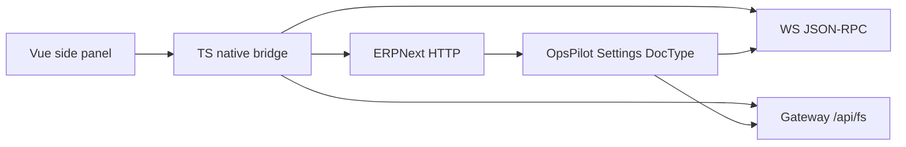

# OpsPilot version-02 — Chromium Side Panel (MV3)

## Overview

Ship OpsPilot as a **Manifest V3 Side Panel** extension for **Chrome, Brave, and Edge** that preserves version-01 product behavior: ERPNext login gate, per-user `OpsPilot Settings` → AI gateway connect, streaming chat, sessions, artifact preview, and transcript export.

Desktop (version-01, tag `version-01`) remains the Tauri 2 client. This spec covers the browser-hosted twin only.

**Browsers:** Chromium MV3 only — Google Chrome, Brave, and Microsoft Edge (same `chrome.*` APIs + Side Panel). Not Firefox/Safari in v2.

## Product scope

Same functional surface as version-01, adapted to a narrow side panel:

| Surface | Behavior |
|---|---|
| Side panel shell | Full-height OpsPilot UI opened from the toolbar action |
| Agent | Streaming transcript + composer; session tabs + clock history; always full width in the panel |
| Artifacts | HTML/PDF preview stacked above the agent when tabs exist; browser URLs open via `chrome.tabs` (no nested Tauri webviews) |
| Settings | ERPNext site URL only; AI credentials stay in ERPNext DocType |
| Boot | Site URL → ERPNext login → OpsPilot probe → AI settings → gateway connect |

**Out (same as v1, plus browser constraints):** local Hermes bootstrap, OAuth, multi-profile connections, voice, terminal, file write/delete, editing Hermes credentials in-app, persisting ERPNext `sid` across browser sessions.

## Authority seams (unchanged)



- **Extension native layer (TypeScript)** owns networking, storage, and the WebSocket dial — the Chrome equivalent of Tauri/Rust.
- **Vue renderer** owns boot gate, layout, and ephemeral UI state (shared components/stores with desktop where possible).
- **ERPNext + `opspilot_frappe`** owns identity and per-user Hermes settings.
- **Hermes gateway** owns sessions, tools, streaming, and remote FS.

Protocol must still match Hermes Desktop remote mode (`/api/status`, password cookies + ws-ticket or token WS, `/api/fs/*`, core RPCs).

## Stack

- Manifest V3 + Side Panel API (`chrome.sidePanel`) — works on Chrome, Brave, and Edge
- Use the `chrome.*` namespace only (all three Chromium browsers expose it; do not depend on Firefox `browser.*` polyfills in v2)
- Vue 3 + Vite + TypeScript + Pinia + frappe-ui (reuse `src/`)
- Networking in the **side panel page** (not the service worker) so the WebSocket stays alive while the panel is open
- Background service worker: open side panel on action click only
- Persist ERPNext site URL (+ last username) and derived connection cache in `chrome.storage.local`
- ERPNext `sid` in `chrome.storage.session` when available; fall back to in-memory + `chrome.storage.session` polyfill via module state if a Chromium build lacks session storage
- Package once (`extension/dist`); load unpacked / publish the same bundle to Chrome Web Store, Brave (Chrome Web Store or Brave store), and Edge Add-ons

## Layout contract (side panel)

```
┌─────────────────────────────┐
│ OpsPilot · Online · ⚙ · ⌨  │
├─────────────────────────────┤
│ Center (optional, stacked)  │  ← HTML/PDF tabs when open
├─────────────────────────────┤
│ Agent: tabs · history · ⋯   │
│ transcript                  │
│ composer                    │
└─────────────────────────────┘
```

- Flat, hairline UI — same visual language as version-01
- Agent is never a thin right rail; it fills the panel width
- Nested browser tabs → open the URL in a normal Chrome tab
- Save As / Downloads → browser download (`chrome.downloads` or blob anchor)

## Implementation phases

| # | Phase | Status |
|---|---|---|
| 1 | **Spec** — this document; tag `version-01` already marks desktop baseline | Done |
| 2 | **Scaffold** — `extension/` MV3 manifest, Vite multi-entry (background + sidepanel), Tauri API shims | Done |
| 3 | **Native bridge** — ERPNext, auth probe/login/ws-ticket, gateway WS JSON-RPC, `/api/fs` | Done |
| 4 | **Side panel shell** — reuse stores/components; agent-first layout; boot gate | Done |
| 5 | **Parity polish** — artifacts, export, downloads, honest empty/error/reconnect | In progress |

## Progress log

### Phase 1 — Spec
- Desktop tagged `version-01`
- MV3 Side Panel chosen as version-02 host for Chrome / Brave / Edge; networking in-panel for WS lifetime

### Phases 2–4 — Scaffold + bridge + shell
- `extension/` MV3 package with `chrome.*` APIs only (Chrome / Brave / Edge)
- Tauri shims → in-panel native TS (ERPNext, auth, WS JSON-RPC, FS, downloads)
- Side panel App: stacked artifacts + full-width agent; browser URLs → `chrome.tabs`

## Taste test

- Does every piece of state still live with its authority?
- Do auth / WS / FS paths still agree with Desktop remote mode?
- Does closing the side panel leave no leaked secrets on disk (`sid` session-only)?
- Can a user complete: URL → login → chat → open HTML artifact → export transcript?
