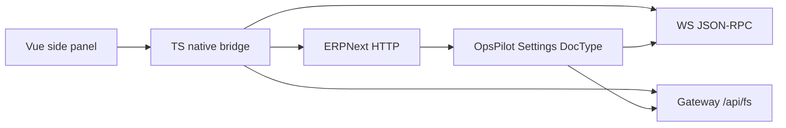

# OpsPilot — Chromium Side Panel (MV3)

## Overview

OpsPilot is a **Manifest V3 Side Panel** extension for **Chrome, Brave, and Edge**: ERPNext Desk gate, per-user `OpsPilot Settings` → AI gateway connect, streaming chat, sessions, artifact preview/download, and transcript export.

It does not ship a desktop/Tauri shell. Historical Tauri notes: [`spec/archive/v1-tauri.md`](./archive/v1-tauri.md).

**Browsers:** Chromium MV3 only — Google Chrome, Brave, and Microsoft Edge. Not Firefox/Safari.

## Product scope

| Surface | Behavior |
|---|---|
| Side panel shell | Full-height OpsPilot UI opened from the toolbar action |
| Agent | Single-column chat: transcript + composer; history overlay; fills the panel |
| Artifacts | Cards in the transcript; Preview → `chrome.tabs`; Download → `chrome.downloads` Save As |
| Settings | Optional site URL override; AI credentials stay in the DocType |
| Boot | Focused OpsPilot Desk tab → Desk session → AI settings → per-site gateway |
| Multi-site | Panel only on `opspilot_frappe` hosts; per-hostname Hermes/session stores ([`multi-site.md`](./multi-site.md)) |
| Refresh | Header control reloads history and remounts artifact extractors |

**Out:** local Hermes bootstrap, OAuth, voice, terminal, file write/delete, editing Hermes credentials in-app, persisting ERPNext `sid`, public tunnels for file sharing, center workspace / nested browser.

**Chat parity with Hermes Desktop:** see [`spec/chat-parity.md`](./chat-parity.md). OpsPilot-only differences: preview (new tab), Save As, Desk link navigation, no tunnels.

## Authority seams



- **Extension native layer (TypeScript)** owns networking, storage, and the WebSocket dial (`extension/native/*`).
- **Vue renderer** owns boot gate, layout, and ephemeral UI state (`src/` + `extension/sidepanel/`).
- **ERPNext + `opspilot_frappe`** owns identity and per-user Hermes settings.
- **Hermes gateway** owns sessions, tools, streaming, and remote FS.

Protocol must match Hermes Desktop remote mode (`/api/status`, password cookies + ws-ticket or token WS, `/api/fs/*`, core RPCs).

## Stack

- Manifest V3 + Side Panel API (`chrome.sidePanel`)
- Vue 3 + Vite + TypeScript + Pinia + frappe-ui
- Companion Frappe app: `frappe-app/opspilot_frappe`

## FS auth (Chromium)

Chrome forbids setting the `Cookie` header on extension `fetch`. Authenticated `/api/fs/*` calls must use `credentials: "include"` against the browser jar (plus optional gateway-tab same-origin fallback). Do not rely on a manual `Cookie` header alone.

## Dev

```bash
npm install
npm run dev          # extension Vite on :1422
npm run build        # → extension/dist (load unpacked)
```

## Progress

### 2026-11-17
- Multi-site: tab-scoped side panel via `opspilot_frappe` ping; per-hostname Hermes sockets + session/chat caches ([`multi-site.md`](./multi-site.md))
- OpsPilot toolbar/extension icon refresh

### 2026-11-16
- Extension-only: removed Tauri/`src-tauri`, desktop shell, `@tauri-apps/*`
- FS download 401 fix (`credentials: include` + gateway-tab fallback)
- No-tunnel client policy + Markdown tunnel notice
- Transcript refresh control
